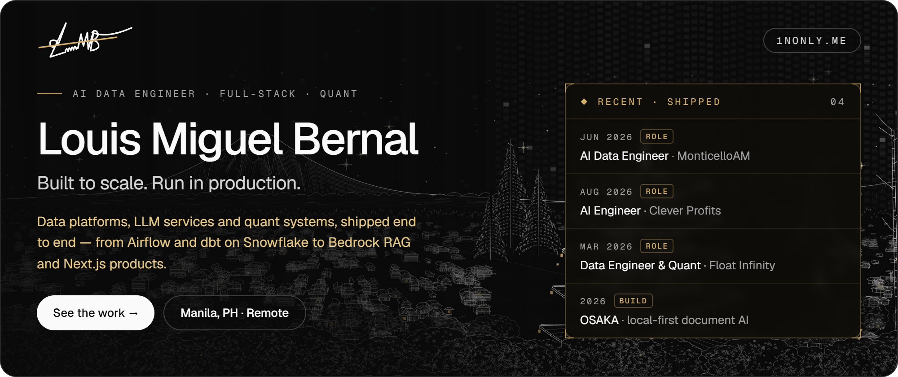
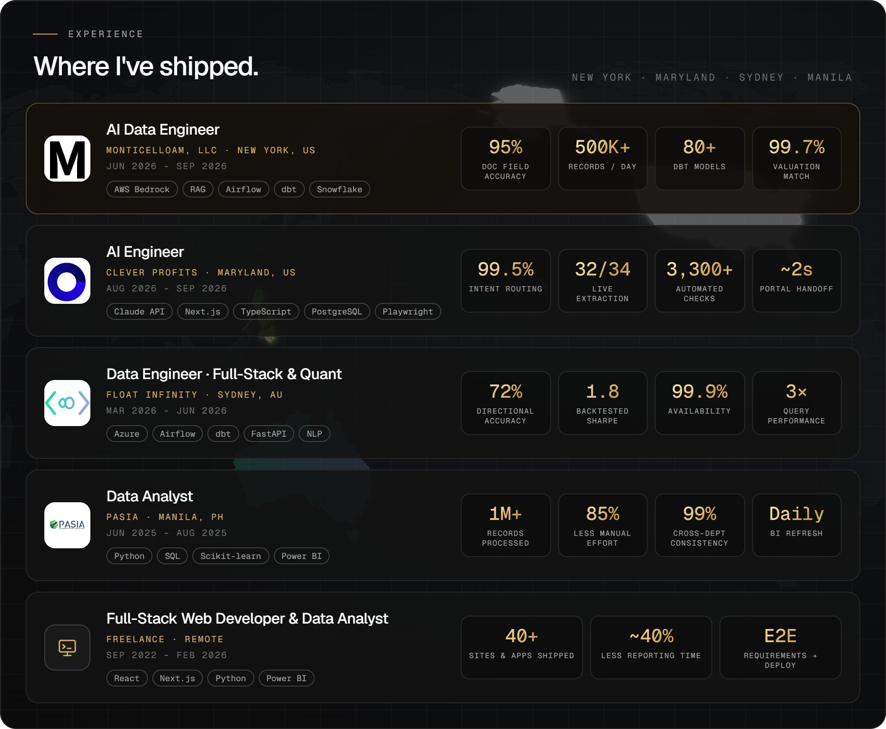
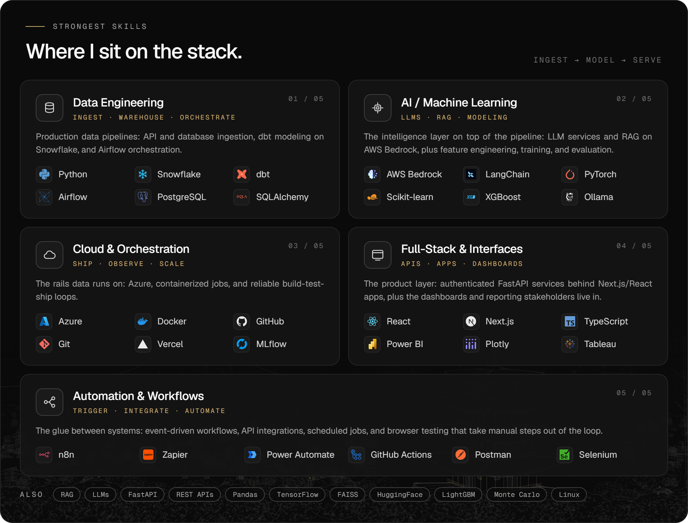

  <a href="https://1nonly.me"><samp>PORTFOLIO</samp></a>
  &nbsp;&nbsp;·&nbsp;&nbsp;
  <a href="https://1nonly.me/resume.pdf"><samp>RESUME</samp></a>
  &nbsp;&nbsp;·&nbsp;&nbsp;
  <a href="https://www.linkedin.com/in/louisbernal/"><samp>LINKEDIN</samp></a>
  &nbsp;&nbsp;·&nbsp;&nbsp;
  <a href="https://x.com/DataMigzz"><samp>X / TWITTER</samp></a>
  &nbsp;&nbsp;·&nbsp;&nbsp;
  <a href="mailto:miguellouis.work@gmail.com"><samp>EMAIL</samp></a>

 

#### <samp>EXPERIENCE</samp>

<b>AI Data Engineer</b> · MonticelloAM, LLC · New York, US · <samp>JUN 2026 – SEP 2026</samp>

 

- Built **AWS Bedrock LLM services** over the warehouse: document intelligence parsing loan files, appraisals and financials at **95% field accuracy**, a confidence-scored entity-resolution matcher against a 14K-row regulatory registry, and a **RAG copilot** on the Snowflake semantic layer — cutting manual entry **80%**.
- Architected and own the **Airflow** ingestion layer across 3 core source systems (Hypha, NetSuite, iLevel) into tiered Snowflake raw schemas, moving **500K+ records/day at 99.9% uptime**.
- Engineered a multi-layer **dbt** backbone on Snowflake (**80+ models**) with reusable data-quality test macros, cutting build and QC time **60%**.
- Rebuilt the portfolio valuation model to a **99.7% identity match** against the reporting tape; shipped GL ingestion with automated reconciliation.

<b>AI Engineer</b> · Clever Profits · Maryland, US · <samp>AUG 2026 – SEP 2026</samp>

 

- Took a client portal's **conversational AI onboarding agent** to production (Next.js 16, React 19, TypeScript, PostgreSQL) on **Claude Haiku 4.5** with voice input — 34 intake fields from free-form speech, submit-to-portal handoff cut from ~5s to **~2s**.
- Designed a deterministic **guardrail layer**: intent router at **99.5%** on 920 labelled turns, per-field validators, PII scrubbing, and digit grounding.
- Built an **adversarial evaluation harness** (105 transcripts, 13 attack classes) with a zero-hallucination gate — **32/34 live extraction accuracy**; grew the suite to **3,300+ automated checks** plus Playwright E2E.
- Shipped per-call AI cost metering, an append-only audited answer store, and a security pass clearing 7 of 8 high-severity advisories.

<b>Data Engineer · Full-Stack Software Engineer & Quant</b> · Float Infinity · Sydney, AU · <samp>MAR 2026 – JUN 2026</samp>

 

- Architected an **Azure** telemetry and reporting platform on **Airflow**-orchestrated REST pipelines — incident detection **50% faster**, **99.9% availability**.
- Production ELT with SQLAlchemy ingestion and version-controlled **dbt** models across 4+ enterprise platforms — **65% less redundancy, 3× query performance**.
- Built an ASX options analytics platform end to end: **FastAPI** market-data service into PostgreSQL, authenticated REST API, **Next.js/React** candlestick and watchlist frontend.
- Trained **NLP/ML trading models** across 15+ instruments with 50+ engineered features — **72% directional accuracy, 1.8 backtested Sharpe**.

<b>Data Analyst</b> · PASIA — Procurement and Supply Institute of Asia · <samp>JUN 2025 – AUG 2025</samp>

 

- Automated preprocessing with ML-based imputation over **1M+ procurement records**, cutting manual effort **85%**.
- Optimized SQL ETL for **99% cross-department consistency** and daily BI refreshes; built Power BI and Excel reporting on top.

<b>Full-Stack Web Developer & Data Analyst</b> · Freelance · Remote · <samp>SEP 2022 – FEB 2026</samp>

 

- Designed and shipped **40+ websites and web apps** (JavaScript, React, Next.js), requirements through production deployment.
- Delivered Power BI and Excel dashboards with repeatable Python cleaning/EDA workflows — **~40% less reporting time**.

 

#### <samp>STRONGEST SKILLS</samp>

 

#### <samp>SELECTED WORK</samp>

| Project | Domain | Summary |
|:--|:--|:--|
| **[OSAKA](https://1nonly.me/osaka)** | AI automation · n8n | Local-first document intelligence: n8n workflows feed PDFs to Gemma 4 on-device, which extracts, grounds and cross-checks every field before a human approves it. |
| **[DeepS&P](https://github.com/LouisMiguelBernal/DeepSP)** · [live](https://deepsp500.streamlit.app/) | Deep learning · Quant finance | Three-layer LSTM trained on 90+ years of S&P 500 data, with Monte Carlo simulation of up to 2,000 stochastic price paths. |
| **[VisorAI](https://github.com/LouisMiguelBernal/VisorAI)** | Computer vision · Mobile | YOLOv11 mobile app detecting LTO road markings in real time, with auditory driver feedback. mAP@0.5 of 0.87 at ~120 ms per frame. |
| **[GiftxAI](https://github.com/LouisMiguelBernal/GiftxAI)** · [live](https://giftxai.streamlit.app/) | LLM · RAG | Retrieval-augmented recommender — FAISS vector store, a triple-validation grounding chain, and a Groq Llama 3.3 backbone. |
| **[QuantMaven](https://github.com/LouisMiguelBernal/QuantMaven)** · [live](https://quantmaven.streamlit.app/) | Market research platform | Research platform for stocks, forex, and crypto — fundamentals, candlestick charting, technical indicators, and algorithmic insights. |
| **[XGE](https://github.com/LouisMiguelBernal/XGE)** · [live](https://xge-ai.streamlit.app/) | ML · Explainability | End-to-end XGBoost pipeline predicting vehicle CO2 emissions, with SHAP explainability and an interactive dashboard. |

 

#### <samp>EDUCATION & LEADERSHIP</samp>

| | | |
|:--|:--|:--|
| **B.S. Computer Science — Intelligent Systems** | De La Salle University — Dasmariñas · 2022 – 2026 | GPA 3.83 / 4.0 · Dean's Lister ×4 |
| **Director — Programming & Creatives** | CSIT Program Council, DLSU-D · 2022 – 2025 | Executive Director, Finance & PR |

 

#### <samp>CERTIFICATIONS</samp>

| Certification | Issuer | Credential |
|:--|:--|:--|
| **Deep Learning Specialization** | DeepLearning.AI · 2025 | [verify](https://coursera.org/verify/5DCEBTE0WLYU) |
| Neural Networks and Deep Learning | DeepLearning.AI | [verify](https://coursera.org/verify/3520567IBKAP) |
| Improving Deep Neural Networks | DeepLearning.AI | — |
| Structuring Machine Learning Projects | DeepLearning.AI | [verify](https://coursera.org/verify/PW7B3FJBJ8L5) |
| Convolutional Neural Networks | DeepLearning.AI | [verify](https://coursera.org/verify/VOPC3983POHV) |
| Sequence Models | DeepLearning.AI | [verify](https://coursera.org/verify/AGSTIN6MFW6H) |

 

<samp>SELECTED ARCHIVE</samp>

 

| Machine learning | Analytics & BI | Markets & NLP |
|:--|:--|:--|
| [Census Income](https://github.com/LouisMiguelBernal/Census-Income) | [House Prices — Power BI + PostgreSQL](https://github.com/LouisMiguelBernal/House-Price-Analysis-Dashboard-with-Power-BI-and-PostgreSQL) | [BTC vs. Economic Indicators](https://github.com/LouisMiguelBernal/BTC-Econimic-Indicators) |
| [Customer Churn](https://github.com/LouisMiguelBernal/Customer-Churn-ML) | [FDIC Failed Banks](https://github.com/LouisMiguelBernal/FDIC-Failed-Banks-Analysis) | [Economic Indicators Forecast](https://github.com/LouisMiguelBernal/Economic-Indicators-Stock-Forecast) |
| [Medical Insurance](https://github.com/LouisMiguelBernal/Medical-Insurance-ML) | [AirBNB](https://github.com/LouisMiguelBernal/AirBNB) | [Google Stock Analysis](https://github.com/LouisMiguelBernal/Google-Stock-Analysis) |
| [California Housing](https://github.com/LouisMiguelBernal/California-Housing-Prediction) | [Starbucks Locations](https://github.com/LouisMiguelBernal/Starbucks-Location-Analysis) | [Top 3 Stock Indexes](https://github.com/LouisMiguelBernal/Top-3-Stock-Indexes-Analysis) |
| [Car Price Prediction](https://github.com/LouisMiguelBernal/Car-Price-Prediction) | [Data Breaches](https://github.com/LouisMiguelBernal/Data-Breach-Analysis) | [Twitter Sentiment](https://github.com/LouisMiguelBernal/Twitter-Sentiment-Analysis) |
| [Face Recognition — SVM](https://github.com/LouisMiguelBernal/Face-Recognition-SVM) | [Global EV Adoption](https://github.com/LouisMiguelBernal/Global-Electric-Vehicle-PostgreSQL-Python-Analysis) | [NLP Emotion](https://github.com/LouisMiguelBernal/NLP-Project) |

 

---

<samp>LOUIS MIGUEL BERNAL &nbsp;·&nbsp; NEW YORK · SYDNEY · MANILA &nbsp;·&nbsp; MMXXVI</samp>

